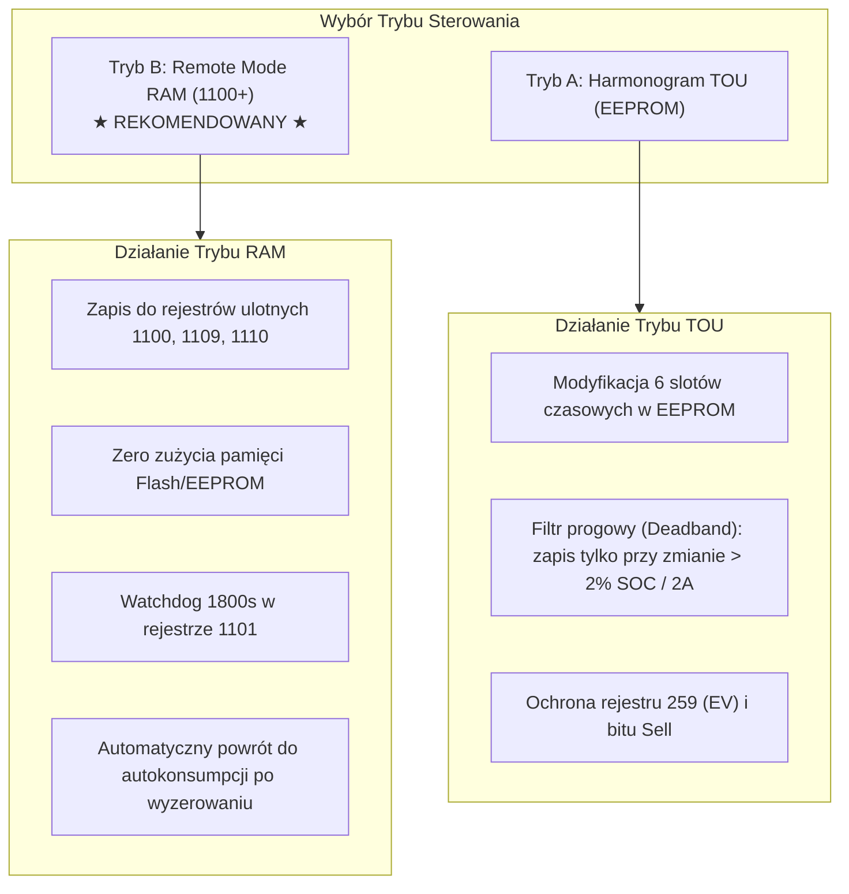

# Deye G12 Optimizer (`deye_g12_opt`)

[](https://github.com/hacs/integration)
[](https://github.com/lespatrick/deye-g12-optimiser/releases)
[](https://opensource.org/licenses/MIT)
[](https://www.home-assistant.io/)

Inteligentna, adaptacyjna integracja Home Assistant do optymalizacji ładowania magazynu energii w hybrydowych falownikach **Deye** (w tym `SUN-15K-SG05LP3-EU-SM2`, serii SG04LP3, SG01/SG03LP1, SG01HP3) oraz w taryfach strefowych **PGE Dystrybucja G12 i G12w** w oparciu o prognozy pogody PV (**Solcast**) oraz historyczne statystyki zużycia domu (**HA Recorder**).

---

## Spis Treści
1. [Dlaczego powstał Deye G12 Optimizer?](#1-dlaczego-powstał-deye-g12-optimizer)
2. [Kluczowe Funkcjonalności](#2-kluczowe-funkcjonalności)
3. [Obsługiwane Modele i Profile Sprzętowe](#3-obsługiwane-modele-i-profile-sprzętowe)
4. [Wymagania Wstępne i Konfiguracja Sprzętu](#4-wymagania-wstępne-i-konfiguracja-sprzętu)
5. [Instrukcja Instalacji Krok po Kroku](#5-instrukcja-instalacji-krok-po-kroku)
6. [Konfiguracja w Home Assistant](#6-konfiguracja-w-home-assistant)
7. [Tryby Sterowania: RAM vs EEPROM](#7-tryby-sterowania-ram-vs-eeprom)
8. [Architektura Dwóch Sesji Planowania (Noc i Popołudnie)](#8-architektura-dwóch-sesji-planowania-noc-i-popołudnie)
9. [Mechanizmy Bezpieczeństwa](#9-mechanizmy-bezpieczeństwa)
10. [Przykładowa Karta Dashboardu Lovelace](#10-przykładowa-karta-dashboardu-lovelace)
11. [Rozwiązywanie Problemów i FAQ](#11-rozwiązywanie-problemów-i-faq)

---

## 1. Dlaczego powstał Deye G12 Optimizer?

Standardowe harmonogramy czasowe (TOU) w inwerterach Deye są statyczne – codziennie ładują baterię do z góry zadanego poziomu stałym prądem, niezależnie od tego:
- czy jutro będzie słoneczny dzień i darmowy prąd z PV przepadnie z powodu braku miejsca w akumulatorze (**Solar Curtailment / utrata autokonsumpcji**),
- czy jutro będzie pochmurno i zabraknie energii w drogim szczycie porannym,
- czy bateria ładuje się agresywnym prądem (np. 100A), niepotrzebnie nagrzewając ogniwa LiFePO4 w 1.5 godziny, zamiast łagodnie rozłożyć ładowanie na całe 8 godzin taniej nocy.

**Deye G12 Optimizer** rozwiązuje te problemy, wprowadzając architekturę 4-warstwową:
1. **Warstwa Danych**: Pobiera godzinowe zużycie domu z bazy HA Recorder, prognozy Solcast na dziś i jutro oraz zegar taryfy PGE G12/G12w.
2. **Warstwa Decyzyjna (`optimizer.py`)**: Matematyczny model wylicza dokładnie tyle energii, ile potrzeba na pokrycie szczytu, rezerwując miejsce na przewidywaną produkcję ze słońca (**Solar Headroom**) i rozkładając prąd ładowania na pełne okno taniego prądu.
3. **Warstwa Wykonawcza (`executor.py`)**: Bezpieczna bramka sprzętowa z filtrem deadband, read-back verification i obsługą rejestrów RAM (brak zużycia pamięci EEPROM).
4. **Warstwa Sprzętowa**: Komunikacja z inwerterem poprzez lokalną integrację `ha-solarman` (Modbus RTU over TCP / port 8899).

---

## 2. Kluczowe Funkcjonalności

- **Precyzyjny Silnik Taryfy PGE G12 & G12w**:
  - Dolina nocna: `22:00 – 06:00` (8 godzin przez cały rok).
  - Dolina dzienna: zima (`13:00 – 15:00`), lato (`15:00 – 17:00`).
  - Taryfa `G12w`: automatyczne 24h taniego prądu w weekendy oraz **wszystkie polskie święta ustawowe** (w tym ruchome: Wielkanoc, Poniedziałek Wielkanocny, Boże Ciało wyliczane wewnętrznym algorytmem Computus bez zewnętrznych bibliotek).
  - Obsługa liczników OSD ze stałym czasem zimowym (`meter_fixed_winter_time`: przesunięcie stref o +1h w lecie DST).
- **Sterowanie Ulotne w Pamięci RAM (Remote Mode 1100+)**:
  - Zapisywanie poleceń mocy i docelowego SOC w rejestrach ulotnych RAM inwertera (`1100–1110`).
  - **Zero zużycia pamięci EEPROM** procesora Deye.
  - Wbudowany 30-minutowy sprzętowy watchdog (rejestr `1101 = 1800s`), zabezpieczający przed przerwami w łączności Wi-Fi/Modbus.
- **Trzypoziomowe Zabezpieczenie Końca Okna Taniego Prądu**:
  - Punktualny wyzwalacz sprzętowy o `06:00:00` i `15:00:00` (`async_end_cheap_window`).
  - Pętla strażnika co 30 sekund: bezwarunkowe zerowanie Remote Mode natychmiast po wykryciu strefy drogiej.
  - Dynamiczny watchdog clamping: skracanie limitu w rejestrze 1101 tuż przed końcem okna.
- **Zarządzanie Stanem 100% SOC i Ochrona Przed Nocnym Rozładowaniem**:
  - Po osiągnięciu 100% w nocy falownik jest celowo utrzymywany w trybie czuwania sieciowego (Standby/Float) do godziny 06:00:00. Dom zasila się z taniej sieci, a pełne 100% w baterii czeka nienaruszone na drogi szczyt poranny.
- **Wsparcie dla Solcast na Dziś i Jutro**:
  - Niezależne selektory dla prognozy na dziś (`pv_forecast_today_entity`) oraz na jutro (`pv_forecast_tomorrow_entity`).
  - Obsługa interwałów 30-minutowych (`detailedForecast`) i godzinowych (`detailedHourly`).
  - Opcjonalny pesymistyczny wariant Solcast P10 (`use_pessimistic_blend` = 70% P50 + 30% P10).
- **Tryb Symulacji (`Simulation Mode`)**:
  - Bezpieczny start: integracja domyślnie uruchamia się w trybie symulacji, logując wszystkie decyzje do dziennika (`logbook.log`) bez wykonywania fizycznych zapisów do inwertera.

---

## 3. Obsługiwane Modele i Profile Sprzętowe

W konfiguracji integracji dostępny jest wybór profilu sprzętowego (`inverter_profile`):

| Profil | Opis | Przykładowe Modele | Rejestry TOU | Uwagi Bezpieczeństwa |
| :--- | :--- | :--- | :--- | :--- |
| **`3PH_LV`** | Trójfazowy Niskonapięciowy | `SUN-15K-SG05LP3-EU-SM2`, `SUN-8/10/12K-SG04LP3` | `146`, `148–177` | **Blokada zapisu do rejestru 259** (ładowarka EV); ochrona bitu Sell w `172–177` |
| **`1PH_LV`** | Jednofazowy Niskonapięciowy | `SUN-3.6/5/6/8K-SG01/03LP1` | `248`, `250–279` | Standardowy harmonogram 1-fazowy |
| **`3PH_HV`** | Trójfazowy Wysokonapięciowy | `SUN-5/6/8/10/15/20K-SG01HP3` | `146`, `148–177` | Skalowanie mocy $\times 10\text{ W}$, bateria HV 160–700V |
| **`ALL_IN_ONE_BK`**| Seria All-in-One | `SUN-BK` | `334`, `335–365` | Zintegrowane magazyny Deye BK |

---

## 4. Wymagania Wstępne i Konfiguracja Sprzętu

1. **Zainstalowana integracja `ha-solarman`**:
   - Zalecana wersja: [`davidrapan/ha-solarman`](https://github.com/davidrapan/ha-solarman) lub `StephanJoubert/home_assistant_solarman`.
   - Połączenie przez Modbus RTU / TCP (logger Wi-Fi/LAN LSW-3 lub konwerter RS485-Ethernet np. Waveshare na porcie 8899).
2. **Kluczowa wskazówka dla `SUN-15K-SG05LP3-EU-SM2`**:
   - Jeśli używasz własnego magazynu energii (DIY / custom LiFePO4 bez fabrycznego mastera CAN Deye), w konfiguracji `ha-solarman` ustaw:
     ```yaml
     battery_packs: -1
     ```
   - Zapobiega to błędom odpytywania nieistniejących pakietów bateryjnych na magistrali.
3. **Wymagane encje w Home Assistant**:
   - Czujnik SOC baterii (np. `sensor.battery_soc`, jednostka `%`).
   - Czujnik całkowitego zużycia domu (np. `sensor.total_load_kwh` lub `sensor.home_consumption_energy`, licznik rosnący kWh).
   - Czujnik prognozy PV (rekomendowany: [Solcast Solar](https://github.com/oziee/ha-solcast-solar)).

---

## 5. Instrukcja Instalacji Krok po Kroku

### Metoda 1: Instalacja przez HACS (Zalecana)

1. Otwórz **HACS** w swoim Home Assistant.
2. Kliknij menu w prawym górnym rogu (trzy kropki) $\rightarrow$ **Niestandardowe repozytoria** (*Custom repositories*).
3. Wklej adres repozytorium:
   ```text
   https://github.com/lespatrick/deye-g12-optimiser
   ```
4. Wybierz typ: **Integracja** (*Integration*) i kliknij **Dodaj**.
5. Znajdź integrację **Deye G12 Optimizer** na liście, kliknij **Pobierz** i pobierz najnowszą wersję.
6. **Zrestartuj Home Assistant**.

### Metoda 2: Instalacja Ręczna

1. Pobierz archiwum ZIP z [najnowszego wydania na GitHubie](https://github.com/lespatrick/deye-g12-optimiser/releases).
2. Rozpakuj zawartość i skopiuj katalog `custom_components/deye_g12_opt` do folderu `/config/custom_components/` w Twojej instalacji Home Assistant.
3. Struktura katalogów powinna wyglądać następująco:
   ```text
   config/
   └── custom_components/
       └── deye_g12_opt/
           ├── __init__.py
           ├── manifest.json
           ├── const.py
           ├── config_flow.py
           ├── coordinator.py
           ├── executor.py
           ├── optimizer.py
           ├── pge_tariff.py
           ├── pv_forecast.py
           ├── recorder_stats.py
           └── ...
   ```
4. **Zrestartuj Home Assistant**.

---

## 6. Konfiguracja w Home Assistant

Po restarcie przejdź do: **Ustawienia** $\rightarrow$ **Urządzenia i usługi** $\rightarrow$ **Dodaj integrację** $\rightarrow$ wyszukaj **Deye G12 Optimizer**.

Konfigurator przeprowadzi Cię przez 3 proste kroki:

### Krok 1: Profil Sprzętowy i Tryb Sterowania
- **Profil sprzętowy falownika**: Wybierz swój model (np. `Trójfazowy Niskonapięciowy (SUN-8/10/12/15K-SG04/SG05LP3)`).
- **Tryb sterowania**:
  - `Tryb B: Szybkie rejestry ulotne RAM 1100+ (Remote Mode)` (**Zalecany**).
  - `Tryb A: Harmonogram TOU w EEPROM` (Tradycyjny).
- **Identyfikator urządzenia Solarman**: (Opcjonalnie) wybierz inwerter z listy urządzeń Solarman.

### Krok 2: Encje Telemetryczne
- **Czujnik poziomu naładowania baterii (SOC)**: np. `sensor.battery_soc`.
- **Czujnik całkowitego zużycia domu (kWh)**: np. `sensor.total_load`.
- **Czujnik prognozy PV na dzisiaj**: np. `sensor.solcast_pv_forecast_forecast_today`.
- **Czujnik prognozy PV na jutro**: np. `sensor.solcast_pv_forecast_forecast_tomorrow`.
- **Czujnik alarmu BMS** (opcjonalny): zatrzymuje ładowanie w przypadku błędu baterii.
- **Czujnik limitu prądu ładowania BMS (CCL)** (opcjonalny): dynamicznie ogranicza prąd ładowania wg BMS.

### Krok 3: Bateria i Taryfa PGE
- **Pojemność znamionowa baterii (kWh)**: np. `15.0`.
- **Napięcie znamionowe baterii (V)**: `51.2` dla LV lub np. `307.2` dla HV.
- **Moc znamionowa falownika (W)**: np. `15000`.
- **Wariant taryfy PGE**: `PGE G12w` lub `PGE G12`.
- **Przesunięcie sezonowe PGE**: włączone (zima 13–15, lato 15–17).
- **Zegar licznika OSD w czasie zimowym**: zaznacz tylko, jeśli Twój licznik PGE nie przestawia czasu na letni (DST).

### Opcje Integracji (Przycisk „Konfiguruj”)
W dowolnym momencie możesz zmienić ustawienia klikając **Konfiguruj** na karcie integracji:
- Zmiana cen energii w szczycie i dolinie (`peak_price`, `off_peak_price`) do estymacji oszczędności arbitrażowych.
- Włączenie pesymistycznego miksu Solcast (`use_pessimistic_blend`: 70% P50 + 30% P10).
- Minimalny rezerwowy SOC (`soc_min`, domyślnie 15%) i maksymalny cel (`soc_max`, domyślnie 100%).
- Zmiana encji prognoz Solcast na dziś i jutro.

---

## 7. Tryby Sterowania: RAM vs EEPROM



---

## 8. Architektura Dwóch Sesji Planowania (Noc i Popołudnie)

Optymalizator wykonuje przeliczenia w dwóch kluczowych momentach doby:

1. **Sesja Nocna (godz. 21:55 / 22:00)**:
   - **Cel**: Przygotowanie magazynu na **poranny szczyt jutra** (`06:00 – 13:00` zima / `06:00 – 15:00` lato).
   - **Prognoza PV**: Pobierana z encji na **JUTRO** (`pv_forecast_tomorrow_entity`).
   - **Wyliczenie**: Jeśli zużycie w porannym szczycie wyniesie 8 kWh, a jutrzejsze słońce dostarczy rano 2 kWh, optymalizator doładuje w nocy brakujące 6 kWh. Prąd ładowania zostanie łagodnie rozłożony na pełne 7.5 godziny nocnego okna.

2. **Sesja Popołudniowa (godz. 12:55 / 13:00 zima / 14:55 / 15:00 lato)**:
   - **Cel**: Przygotowanie magazynu na **wieczorny szczyt dzisiejszego dnia** (`15:00 – 22:00` zima / `17:00 – 22:00` lato).
   - **Prognoza PV**: Pobierana z encji na **DZISIAJ** (`pv_forecast_today_entity`).
   - **Wyliczenie**: Analizuje resztkę dzisiejszej generacji ze słońca przed zachodem. W razie potrzeby dobija baterię z taniej sieci w oknie popołudniowym, aby zapobiec poborowi drogiego prądu wieczorem.

---

## 9. Mechanizmy Bezpieczeństwa

- **Domyślny Tryb Symulacji (`Simulation Mode`)**:
  Po pierwszej instalacji przełącznik `switch.deye_g12_optimizer_simulation_mode` jest włączony. Integracja wykonuje wszystkie obliczenia i loguje je do Home Assistant, ale **nie wysyła żadnych komend zapisu do falownika**. Dopiero po upewnieniu się, że wyliczenia są poprawne, wyłącz tryb symulacji w interfejsie.
- **Punktualne wyłączenie ładowania (`06:00:00` i `15:00:00`)**:
  Wprowadzona w wersji `v1.1.15` metoda `async_end_cheap_window()` punktualnie co do sekundy zeruje rejestry mocy (`1109 = 0`, `1100 = 0`, `1101 = 0`) i przełącza falownik w zasilanie domu z baterii.
- **Sprzętowy Watchdog Clamping**:
  Rejestr `1101` jest dynamicznie skracany w ostatnich minutach taniego okna (np. do 300s o 05:55), dzięki czemu inwerter sprzętowo odetnie ładowanie nawet w przypadku awarii Home Assistanta.
- **BMS Safety Guard**:
  Wykrycie aktywnego alarmu BMS lub brak odczytu baterii natychmiast przerywa i blokuje proces ładowania.
- **Ochrona Rejestru 259**:
  W profilu trójfazowym `3PH_LV` integracja posiada sprzętową blokadę uniemożliwiającą wysłanie zapisu pod adres `259` (gdzie w modelu `SUN-15K-SG05LP3` znajduje się konfiguracja ładowarki samochodowej EV).

---

## 10. Przykładowa Karta Dashboardu Lovelace

Wklej poniższy kod w Dashboardzie Home Assistant (**Edytuj pulpit** $\rightarrow$ **Dodaj kartę** $\rightarrow$ **Karta ręczna / Manual**):

```yaml
type: vertical-stack
cards:
  # 1. Nagłówek ze strefą taryfową i statusem
  - type: custom:mushroom-template-card
    primary: Deye G12 Optimizer
    secondary: >-
      Strefa: {{ states('sensor.deye_g12_optimizer_current_tariff_zone') }} |
      {{ states('sensor.deye_g12_optimizer_last_execution_status') }}
    icon: mdi:battery-charging-wireless
    icon_color: >-
      
        green
      
        amber
      
    tap_action:
      action: more-info
      entity: sensor.deye_g12_optimizer_planned_soc_target

  # 2. Porównanie aktualnego SOC z celem planu
  - type: horizontal-stack
    cards:
      - type: gauge
        entity: sensor.battery_soc
        name: Aktualny SOC
        min: 0
        max: 100
        needle: true
        severity:
          red: 0
          amber: 20
          green: 80

      - type: gauge
        entity: sensor.deye_g12_optimizer_planned_soc_target
        name: Cel Planu G12
        min: 0
        max: 100
        needle: true
        severity:
          red: 0
          amber: 30
          green: 75

  # 3. Parametry bilansu i decyzji
  - type: entities
    title: Bilans Energetyczny
    show_header_toggle: false
    entities:
      - entity: sensor.deye_g12_optimizer_planned_charge_current
        name: Zadany Prąd Ładowania
        icon: mdi:current-ac
      - entity: sensor.deye_g12_optimizer_pv_headroom_max_soc
        name: Rezerwacja na Słońce (Headroom)
        icon: mdi:solar-power-variant
      - entity: sensor.deye_g12_optimizer_expected_morning_pv
        name: Prognoza Generacji PV
        icon: mdi:weather-sunny
      - entity: sensor.deye_g12_optimizer_expected_morning_load
        name: Przewidywane Zużycie Domu
        icon: mdi:home-lightning-bolt
      - entity: sensor.deye_g12_optimizer_estimated_daily_arbitrage_savings
        name: Dzienne Oszczędności Arbitrażu
        icon: mdi:cash-multiple
      - entity: switch.deye_g12_optimizer_simulation_mode
        name: Tryb Symulacji (Bezpieczeństwo)
      - entity: switch.deye_g12_optimizer_automation_active
        name: Automatyzacja Falownika

  # 4. Przycisk natychmiastowego przeliczenia
  - type: button
    name: Przelicz Plan Teraz
    icon: mdi:calculator
    tap_action:
      action: call-service
      service: deye_g12_opt.recalculate
```

*(Uwaga: Jeśli nie posiadasz zainstalowanego dodatku Mushroom, nagłówek możesz zastąpić standardową kartą `glance`)*.

---

## 11. Rozwiązywanie Problemów i FAQ

### Q1: Błąd `Failed setting Remote Mode registers: 'ConfigEntry' object has no attribute 'runtime_data'`
- **Wyjaśnienie**: Błąd ten występował w starszych wersjach `ha-solarman`, gdy usługa `solarman.write_multiple_registers` nie potrafiła prawidłowo rozwiązać urządzenia.
- **Rozwiązanie**: W wersji `v1.1.14+` nasz optymalizator automatycznie omija ten błąd, wykonując bezpośredni, bezpieczny zapis przez koordynatora urządzenia (`coord.execute(16, address, [value])`).

### Q2: Czy krótkie zerwanie połączenia Wi-Fi/Solarman przerywa ładowanie?
- **Nie**. W wersji `v1.1.13+` limit czasu watchdoga został ustawiony na **1800 sekund (30 minut)**. Jeśli połączenie z loggerem zostanie na chwilę utracone, falownik kontynuuje ładowanie zadanym prądem, a koordynator ponawia próbę odświeżenia rejestru 1101 co 30 sekund.

### Q3: Bateria naładowała się do 100% o 03:30 w nocy. Dlaczego inwerter nie przechodzi na zasilanie domu z baterii?
- **Jest to zamierzone i chroni Twoje oszczędności**. Do godziny 06:00 rano obowiązuje tania strefa nocna (np. 0.55 zł/kWh). Gdyby falownik zaczął zasilać dom z baterii w nocy, do godziny 06:00 zużyłby np. 7–10% energii, którą musiałbyś dokupić w drogim szczycie porannym (1.19 zł/kWh). Optymalizator utrzymuje baterię w stanie Standby/Float do 06:00:00, zasilając dom z taniej sieci.

### Q4: Jak wymusić natychmiastowe przeliczenie planu po zmianie ustawień?
- Możesz wywołać usługę w Narzędziach Deweloperskich Home Assistant:
  ```yaml
  action: deye_g12_opt.recalculate
  data:
    plan_type: "night"  # lub "midday"
  ```
  lub kliknąć przycisk **Przelicz Plan Teraz** na powyższej karcie Dashboardu.

---

## Licencja

Projekt udostępniany jest na zasadach licencji [MIT License](LICENSE).
Twórca i współtwórcy: [@lespatrick](https://github.com/lespatrick).
